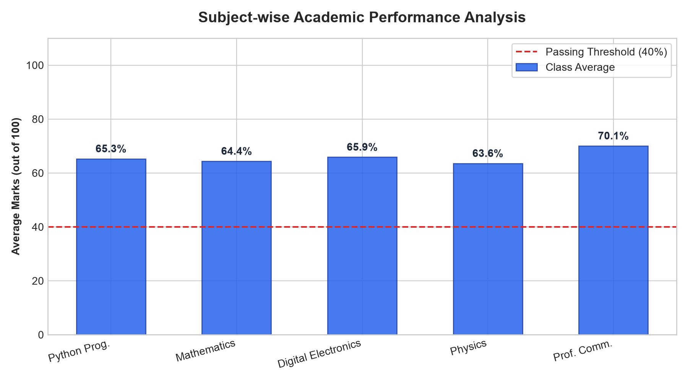
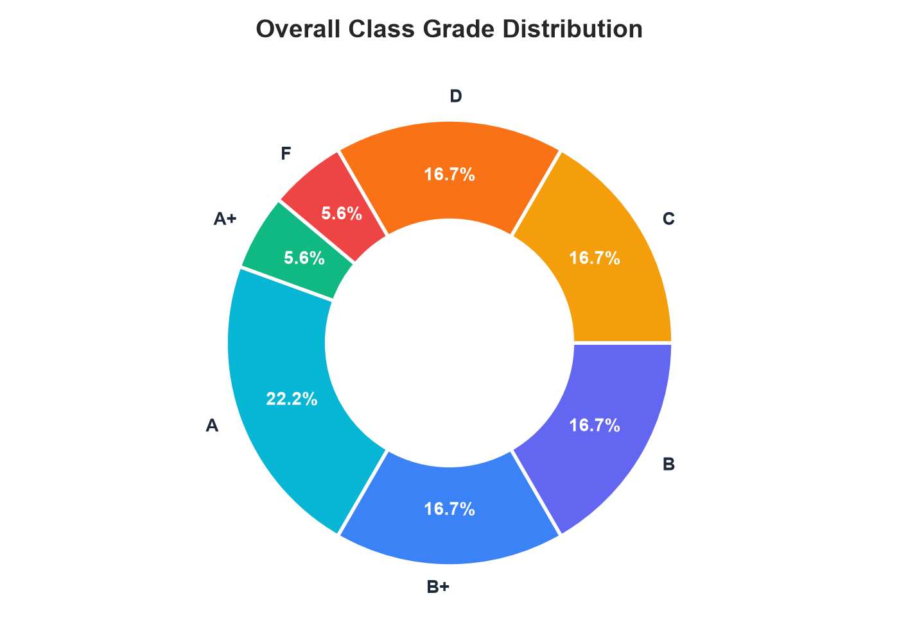
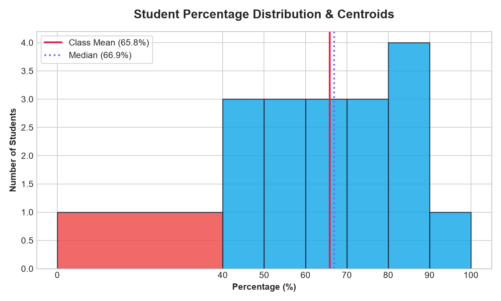

# Python Collaborative Project Report: Student Result Management System

**Course:** Computational Thinking and Programming  
**Course Code:** 2026CSAE100  
**Evaluation:** Milestone 2 – Final Project Evaluation & Viva Voce  
**Date:** November 2026  

---

## 1. Project Title and Team Details

**Project Title:** Student Result Management System  
**System Architecture:** Python Computational Engine, Statistical Analyzer, and Interactive Web Dashboard  

### Team Details & Assigned Roles

| S. No. | Student Name | Enrollment Number | Assigned Project Role | Specific Contribution Focus |
| :---: | :--- | :---: | :--- | :--- |
| **1** | **Prisha Mishra** | S26CSEU1899 | Research & Python concept analysis | Computational thinking decomposition, grading tuple scales, data structures design |
| **2** | **Kinjal Kadiyan** | S26CSEU1905 | Research & project planning | Workflow design, algorithm flowcharts, rule-based diagnostic criteria |
| **3** | **Arnav Mittal** | S26CSEU1901 | Input & data management | CSV data persistence engine, input validation loops, duplicate prevention |
| **4** | **Payal Kansal** | S26CSEU1907 | Testing & error checking | Automated unit testing suite (`unittest`), boundary verification, exception handling |
| **5** | **Jishnu Priya Hasini** | S26CSEU1887 | Documentation & presentation | Formal 10-section report, 12-slide PowerPoint presentation, Viva Voce guide |

---

## 2. Problem Statement

In academic institutions, calculating and evaluating student examination performance manually is cumbersome, slow, and prone to mathematical mistakes. Traditional spreadsheet records:
1. Require manual summation, percentage computation, and grade lookups, resulting in frequent human error.
2. Provide no immediate computational insights such as class standard deviations, subject pass rates, or competition rankings with tie-breaking.
3. Fail to provide early warning diagnostics: teachers cannot easily identify students falling behind class averages before end-term examinations.
4. Make generating individual student report cards repetitive and labor-intensive.

**The Solution:**  
The **Student Result Management System** is a modular Python software solution that automates academic score processing. It accepts student marks across 5 core subjects, enforces strict input validation, computes aggregate metrics (total, percentage, GPA, grade), determines fair competition rankings with tie-breaking, performs statistical dispersion analysis (mean, median, standard deviation), provides rule-based prescriptive academic recommendations, and presents the entire workflow through both a clean Terminal CLI and a modern Web Dashboard.

---

## 3. Objectives

As formulated in Milestone 1 and achieved in Milestone 2:

1. **Structured Data Intake & Validation:** To accept and validate student marks for 5 subjects with defensive boundary checks ($0 \le \text{mark} \le 100$) and duplicate roll number protection.
2. **Automated Academic Grading:** To accurately calculate aggregate totals, percentages, GPAs (10.0 scale), and assign standardized letter grades (A+ to F) using immutable grade boundaries.
3. **Class-Wide Statistical Computation:** To calculate class metrics including mean, median, population standard deviation ($\sigma$), highest/lowest performers, and subject-wise pass rates.
4. **Fair Competition Ranking:** To implement a competition ranking algorithm with fair tie handling (e.g. 1, 2, 2, 4) and relative percentiles.
5. **Rule-Based Diagnostic Intelligence:** To analyze individual student subject scores against class averages, generating actionable remedial advice and honors recognition.
6. **Multi-Platform Presentation & Persistence:** To persist records in CSV format, export ASCII marksheet text files, and deliver an interactive Web Dashboard.

---

## 4. Main Features / Modules

### 4.1 Core Computational Engine (`core/result_engine.py`)
- **Metric Calculations:** Computes total marks, percentage, and 10-point GPA.
- **Grade Classification:** Maps percentages to grades using the immutable `GRADE_SCALE` tuple.
- **Fail Detection:** Uses Python set operations to identify subjects with marks $< 40$.
- **Competition Ranking:** Multi-key sorting with tie preservation.
- **Statistical Analyzer:** Computes class mean, median, standard deviation, and subject-wise metrics.

### 4.2 Rule-Based Academic Diagnostic Engine
- **Remedial Flags:** Identifies marks $< 40$ or $>10\%$ below class average. Prescribes weekly remedial tutorials and problem sets.
- **Mastery Badges:** Recognizes scores $\ge 90$ with honors and peer-mentorship recommendations.
- **Discrepancy Alerts:** Detects large score gaps ($\ge 35$ marks) between best and worst subjects.

### 4.3 Data Persistence & File Handling
- **CSV Data Storage:** Reads and writes `data/students.csv` using Python's standard `csv.DictReader` and `csv.DictWriter`.
- **ASCII Marksheet Generation:** Generates individual formatted text report cards in `data/reports/`.

### 4.4 Data Visualizer (`core/visualizer.py`)
- Generates 3 Matplotlib analytical charts:
  1. `subject_averages.png`: Subject-wise class averages with a 40% passing benchmark reference line.
  2. `grade_distribution.png`: Class grade breakdown donut chart.
  3. `score_distribution.png`: Histogram indicating score spread with class mean and median centroids.

### 4.5 Dual User Interface
- **Interactive Terminal CLI (`main.py`):** Colorful ANSI menus for terminal evaluation and lab viva.
- **Interactive Web Dashboard (`app.py` & `static/`):** Real-time search, multi-column sorting, modal forms with live calculation, and printable marksheets.
- **Zero-Dependency Fallback Server (`server.py`):** Built entirely with Python's standard library `http.server` with zero external pip dependencies.

---

## 5. Algorithm / Flowchart / Program Design

### 5.1 Algorithmic Sequence

```
[Start]
   │
   ▼
[Load students from CSV (data/students.csv)]
   │
   ▼
[User Input: Roll Number, Student Name, 5 Subject Marks]
   │
   ▼
<Are all marks numbers between 0 and 100?>
   ├─► [NO] ──► Display descriptive error; re-prompt input
   │
   ▼ [YES]
<Does Roll Number already exist in class set?>
   ├─► [YES] ──► Reject duplicate; prompt unique roll number
   │
   ▼ [NO]
[Calculate Total Marks = Σ(subject_marks)]
[Calculate Percentage = (Total / 500) * 100]
   │
   ▼
[Determine Letter Grade & GPA using GRADE_SCALE tuple]
   │
   ▼
[Check Subject Failures: failed_set = {s for s, m in marks if m < 40}]
[Determine Status: 'PASS' if Percentage >= 40 and len(failed_set) == 0 else 'FAIL']
   │
   ▼
[Insert record into student list; Recompute Competition Rankings]
   │
   ▼
[Compute Descriptive Statistics: Mean, Median, StdDev, Subject Stats]
   │
   ▼
[Run Rule-Based Diagnostic Engine to produce tailored recommendations]
   │
   ▼
[Save updated list to CSV & Generate ASCII Report Card]
   │
   ▼
[Display Results / Update Web Interface]
   │
   ▼
[End]
```

### 5.2 Mathematical Formulations

1. **Total Marks:**
   $$\text{Total} = \sum_{i=1}^{n} \text{Mark}_i$$

2. **Percentage:**
   $$\text{Percentage} = \left(\frac{\text{Total}}{n \times 100}\right) \times 100$$

3. **Class Mean ($\mu$):**
   $$\mu = \frac{1}{N} \sum_{j=1}^{N} \text{Percentage}_j$$

4. **Population Standard Deviation ($\sigma$):**
   $$\sigma = \sqrt{\frac{1}{N} \sum_{j=1}^{N} (\text{Percentage}_j - \mu)^2}$$

5. **Competition Rank:**
   $$\text{Rank}_k = 1 + \sum_{j \ne k} \mathbb{I}(\text{Percentage}_j > \text{Percentage}_k)$$

6. **Percentile:**
   $$\text{Percentile}_k = \left(\frac{\text{Count of students with } \text{Percentage} < \text{Percentage}_k}{N}\right) \times 100$$

---

## 6. Python Concepts Used

| Concept | Implementation in Project | Code Reference |
| :--- | :--- | :--- |
| **Lists** | Maintains ordered collection of student records for ranking, searching, and table display. | `students: List[Dict[str, Any]]` |
| **Tuples** | Immutability for fixed constants: `GRADE_SCALE` and `SUBJECTS`. Prevents accidental runtime mutation. | `GRADE_SCALE: Tuple[...]`, `SUBJECTS: Tuple[...]` |
| **Dictionaries** | Structured key-value mapping for student records, subject marks, and analytical payloads. | `{'roll_no': ..., 'marks': {'Python': 95, ...}}` |
| **Sets** | Set comprehension to detect failed subjects without duplicate entries; uniqueness check on roll numbers. | `{sub for sub, mark in marks.items() if mark < 40}` |
| **Functions & Modularity** | Modular decomposition with clean input arguments, return types, and descriptive docstrings. | `process_student_record()`, `compute_class_rankings()` |
| **File I/O** | Reading and writing CSV data; generating formatted ASCII text report card files on disk. | `csv.DictReader()`, `open(path, 'w', encoding='utf-8')` |
| **Exception Handling** | Defensive programming using `try-except` blocks for `ValueError`, `KeyError`, and `FileNotFoundError`. | `try: float(val) except ValueError:` |
| **Loops & Conditionals** | Validation loops, multi-tier grading evaluation, and list comprehensions for statistical calculation. | `while True:`, `if percentage >= min_pct:` |

---

## 7. Important Screenshots / Outputs

### 7.1 Web Dashboard & Academic Marksheet
- **Figure 7.1: Interactive Web Dashboard**  
    
  *Features real-time KPI metric cards, filters by grade/status, search by student name/roll number, and dynamic ranking table.*

- **Figure 7.2: Official Academic Performance Marksheet**  
    
  *Displays individual student marksheet modal with GPA, class percentile, and prescriptive Rule-Based Diagnostic Feedback.*

### 7.2 Terminal CLI & Computational Charts
- **Figure 7.3: Interactive Terminal CLI (main.py)**  
    
  *ANSI colored interactive terminal menu for console viva evaluation.*

- **Figure 7.4: Subject-wise Performance vs. 40% Benchmark**  
    
  *Matplotlib bar chart illustrating subject averages and passing threshold line.*

- **Figure 7.5: Class Grade Distribution Donut Chart**  
    
  *Visual breakdown of letter grades across student cohort.*

- **Figure 7.6: Score Spread Histogram**  
    
  *Histogram displaying score frequency distribution with Mean and Median centroid markers.*

### 7.3 Sample ASCII Report Card (`data/reports/Report_Card_S26CSEU1899.txt`)

```text
====================================================================
               ACADEMIC PERFORMANCE REPORT CARD
             Course: Computational Thinking (2026CSAE100)
====================================================================
 Roll Number: S26CSEU1899        Student Name: Prisha Mishra
 Final Rank : #1                 Class Percentile: 100.0%
 Final Grade: A+ (Outstanding )  Result Status  : PASS
--------------------------------------------------------------------
 SUBJECT                          MAX    OBTAINED   STATUS  
--------------------------------------------------------------------
 Python Programming               100    95.0       PASS    
 Mathematics                      100    92.0       PASS    
 Digital Electronics              100    94.0       PASS    
 Physics                          100    89.0       PASS    
 Professional Communication       100    96.0       PASS    
--------------------------------------------------------------------
 Total Marks : 466.0 / 500       Percentage: 93.20%
 Grade Points: 10.0 / 10.0
====================================================================
 ACADEMIC DIAGNOSTICS & RECOMMENDATIONS:
  • [EXCELLENCE] Overall Academic Standing:
    Outstanding overall achievement! Eligible for honors list, peer tutoring, and advanced project work.
  • [MASTERY] Python Programming:
    Exceptional mastery in Python Programming (95.0/100). Consider undertaking competitive algorithmic challenges or mini research projects.
  • [MASTERY] Mathematics:
    Exceptional mastery in Mathematics (92.0/100).
  • [MASTERY] Digital Electronics:
    Exceptional mastery in Digital Electronics (94.0/100).
  • [MASTERY] Professional Communication:
    Exceptional mastery in Professional Communication (96.0/100).
====================================================================
 Note: Minimum 40% required per subject and aggregate for PASS.
====================================================================
```

---

## 8. Testing (Role: Payal Kansal)

The test suite was executed via `python3 -m unittest StudentResultManagementSystem/tests/test_result_system.py`. All 11 unit test cases passed with a **100% success rate (0 failures, 0 errors)**.

| Test ID | Test Case Description | Test Input | Expected Output | Actual Output | Status |
| :---: | :--- | :--- | :--- | :--- | :---: |
| **TC-01** | Grade Scale Boundaries | Percentages: 95, 90, 85, 80, 75, 70, 65, 60, 55, 50, 45, 40, 39.9, 0 | Correct grades (A+, A, B+, B, C, D, F) | Exactly matched expected grades | **PASS** |
| **TC-02** | Valid Student Calculation | Marks: 85, 90, 80, 75, 80 | Total: 410.0, %: 82.0%, Grade: A, Status: PASS | Total: 410.0, %: 82.0%, Grade: A, Status: PASS | **PASS** |
| **TC-03** | Subject-Level Failure | Total > 40%, but Physics = 32 | Status: FAIL, failed_subjects contains 'Physics' | Status: FAIL, 'Physics' in failed_subjects | **PASS** |
| **TC-04** | Negative Marks Validation | Mathematics mark: -5.0 | `validate_marks` returns `False` with error message | Returned `False` with "between 0 and 100" | **PASS** |
| **TC-05** | Upper Bound Validation | Python mark: 105.0 | `validate_marks` returns `False` with error message | Returned `False` with "between 0 and 100" | **PASS** |
| **TC-06** | Missing Subject Key | Dictionary missing 'Physics' | `validate_marks` returns `False` with "Missing marks" | Returned `False` with "Missing marks for subject" | **PASS** |
| **TC-07** | Exception Handling | Passing invalid marks to `process_student_record` | Raises `ValueError` cleanly | `ValueError` raised as expected | **PASS** |
| **TC-08** | Competition Ranking Ties | Two students tied at 90%, one at 70% | Ranks: #1, #1, #3 (next rank accounts for tie) | Assigned ranks: 1, 1, 3 | **PASS** |
| **TC-09** | Class Statistics Math | 3 records: 90%, 70%, 50% | Mean: 70.0%, Median: 70.0%, StdDev: 16.33% | Mean: 70.0%, Median: 70.0%, StdDev: 16.33% | **PASS** |
| **TC-10** | Rule-Based Diagnostic | Student with Digital Electronics = 35 | Generates "Remedial Attention" for Electronics | Flagged with remedial tutorial recommendation | **PASS** |
| **TC-11** | CSV Round-Trip Integrity | Save & reload temporary CSV | Record reloaded with identical values and no data loss | 100% data integrity verified | **PASS** |

---

## 9. Team-Member Contributions

| Member Name | Enrollment No. | Assigned Role | Key Technical Contributions |
| :--- | :---: | :--- | :--- |
| **Prisha Mishra** | S26CSEU1899 | Research & Python Concept Analysis | Researched academic evaluation standards; designed tuple structures for immutable grading thresholds (`GRADE_SCALE`); analyzed ranking algorithms; formulated computational problem decomposition. |
| **Kinjal Kadiyan** | S26CSEU1905 | Research & Project Planning | Defined project scope, milestone deliverables, and workflow schedule; designed the primary algorithmic flowchart; planned rule-based diagnostic triggers and advisory messages. |
| **Arnav Mittal** | S26CSEU1901 | Input & Data Management | Developed the CSV persistence engine (`load_students_from_csv`, `save_students_to_csv`); engineered defensive input validation loops; curated seed dataset of 18 students. |
| **Payal Kansal** | S26CSEU1907 | Testing & Error Checking | Authored the 11-case automated test suite using `unittest`; tested boundary conditions, non-numeric values, and ranking ties; verified exception handling and error prevention. |
| **Jishnu Priya Hasini** | S26CSEU1887 | Documentation & Presentation | Authored the formal 10-section project report; designed the 12-slide PowerPoint presentation (`.pptx`); created the comprehensive Viva Voce preparation guide and code walkthroughs. |

---

## 10. Conclusion and Future Improvements

### 10.1 Conclusion
The **Student Result Management System** satisfies all project guidelines and academic criteria outlined in the Computational Thinking and Programming course. It highlights how core Python constructs—functions, lists, tuples, dictionaries, sets, and file I/O—can be synthesized to engineer a reliable software product. By incorporating statistical analysis and rule-based diagnostics, the system moves beyond basic arithmetic to offer meaningful insights for students and faculty alike.

### 10.2 Future Improvements
1. **Multi-Semester Cumulative GPA (CGPA) Tracking:** Extend the data model to store multi-semester transcripts and plot longitudinal GPA trends.
2. **Automated Email Dispatch:** Integrate Python's `smtplib` to automatically dispatch generated report cards directly to students and parents.
3. **Role-Based Authentication:** Implement secure login portals separating Faculty (with grade entry privileges) and Students (read-only transcript view).
4. **Attendance Correlation Engine:** Integrate student attendance records to compute statistical correlation between attendance percentages and subject performance.
